<picture>
  <source media="(prefers-color-scheme: dark)" srcset="https://raw.githubusercontent.com/Ryoko-Development/.github/main/profile/assets/hero-dark.svg">
  
</picture>

**Independent software development.**  
Desktop utilities, game visuals and carefully designed interfaces.

<picture>
  <source media="(prefers-color-scheme: dark)" srcset="https://raw.githubusercontent.com/Ryoko-Development/.github/main/profile/assets/products-dark.svg">
  
</picture>

`C#` · `.NET` · `Java` · `C++` · `TypeScript`

[Repositories](https://github.com/orgs/Ryoko-Development/repositories) · [GitHub](https://github.com/Ryoko-Development)

RYOKO DEVELOPMENT / DESIGN × ENGINEERING

