<picture>
  <source media="(prefers-color-scheme: dark)" srcset="https://raw.githubusercontent.com/Ryoko-Development/.github/main/profile/assets/hero-dark.svg?v=20261128">
  
</picture>

[Website](https://ryoko-software.vercel.app/) · [Telegram](https://t.me/ryoko_official) · [Repositories](https://github.com/orgs/Ryoko-Development/repositories)

<picture>
  <source media="(prefers-color-scheme: dark)" srcset="https://raw.githubusercontent.com/Ryoko-Development/.github/main/profile/assets/products-dark.svg?v=20261128">
  
</picture>

<picture>
  <source media="(prefers-color-scheme: dark)" srcset="https://raw.githubusercontent.com/Ryoko-Development/.github/main/profile/assets/engineering-dark.svg?v=20261128">
  
</picture>

<picture>
  <source media="(prefers-color-scheme: dark)" srcset="https://raw.githubusercontent.com/Ryoko-Development/.github/main/profile/assets/network-dark.svg?v=20261128">
  
</picture>

[Official website](https://ryoko-software.vercel.app/) &nbsp; / &nbsp; [Telegram channel](https://t.me/ryoko_official) &nbsp; / &nbsp; [GitHub](https://github.com/Ryoko-Development)

RYOKO DEVELOPMENT · SOFTWARE, REFINED.

